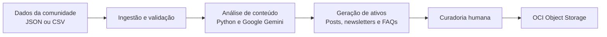

# CommunityLab

Motor inteligente de transformação e distribuição de conteúdo para comunidades digitais.

Projeto desenvolvido para o Hackathon ONE G10, por equipes da Oracle Next Education e Alura.

## Visão geral

O CommunityLab transforma interações e conquistas de comunidades digitais em conteúdo estratégico para canais como LinkedIn, X (Twitter) e newsletters.

O projeto recebe dados em JSON ou CSV, processa temas e sentimentos, gera ativos de comunicação e apresenta os resultados para curadoria humana antes da aprovação.

### Funcionalidades planejadas

- Leitura e validação de arquivos JSON e CSV.
- Análise de sentimentos e extração de temas.
- Geração de posts, newsletters e FAQs.
- Curadoria, edição e aprovação dos materiais gerados.
- Persistência dos ativos aprovados no OCI Object Storage.
- Execução de testes unitários e de integração.

## Como funciona



O fluxo completo é organizado em três camadas principais:

1. **Apresentação:** interface Streamlit para entrada de dados e curadoria.
2. **Serviços:** processamento, análise, geração de conteúdo e orquestração.
3. **Persistência:** armazenamento dos ativos aprovados no OCI Object Storage.

Consulte a [documentação de arquitetura](docs/arquitetura.md) para conhecer o fluxo detalhado.

## Stack tecnológica

| Tecnologia | Finalidade |
| --- | --- |
| Python | Linguagem principal do projeto |
| Streamlit | Interface web |
| LangChain | Composição das integrações de IA |
| LangGraph | Orquestração do pipeline |
| Google Gemini | Análise e geração de conteúdo |
| OCI Object Storage | Persistência dos ativos aprovados |
| pandas | Manipulação de dados estruturados |
| Pydantic | Validação dos modelos de dados |
| pytest | Testes automatizados |
| Git e GitHub | Controle de versão e colaboração |
| Trello | Organização das tarefas |

## Estado atual da implementação

Este repositório possui uma base funcional para análise de sentimentos e contém uma interface Streamlit inicial.

| Componente | Estado |
| --- | --- |
| Interface Streamlit | Implementada parcialmente |
| Upload de JSON/CSV | Disponível na interface |
| Análise de sentimentos | Implementada em módulos Python |
| Testes automatizados | Disponíveis |
| Integração com Google Gemini | Em desenvolvimento |
| Orquestração completa do pipeline | Em desenvolvimento |
| Geração de conteúdos | Em desenvolvimento |
| Integração com OCI Object Storage | Em desenvolvimento |

Para informações detalhadas, consulte a [documentação técnica e de stack](docs/ARQUITETURA_E_STACK.md).

## Pré-requisitos

- Python 3.10 ou superior.
- Git.
- Chave de API do Google Gemini, quando a integração estiver em uso.
- Credenciais OCI, quando o armazenamento estiver configurado.

## Instalação

### Windows

```powershell
git clone https://github.com/Coutfernandes/MotorInteligente-G10.git
cd MotorInteligente-G10
python -m venv .venv
.venv\Scripts\Activate.ps1
python -m pip install -r requirements.txt
Copy-Item .env.example .env
```

### Linux ou macOS

```bash
git clone https://github.com/Coutfernandes/MotorInteligente-G10.git
cd MotorInteligente-G10
python3 -m venv .venv
source .venv/bin/activate
python -m pip install -r requirements.txt
cp .env.example .env
```

## Configuração

Edite o arquivo `.env` criado a partir de `.env.example`.

```dotenv
GOOGLE_API_KEY=sua_chave_do_gemini
LLM_PROVIDER=gemini
LLM_MODEL=gemini-1.5-flash
```

Não versionar credenciais, chaves privadas ou arquivos `.env`.

## Execução

Inicie a aplicação Streamlit:

```bash
streamlit run src/app/main.py
```

Em seguida, acesse o endereço informado pelo terminal, normalmente `http://localhost:8501`.

A tela atual pode ser executada sem credenciais. O uso completo das integrações de IA e OCI depende das respectivas configurações.

## Testes

Execute os testes automatizados com:

```bash
pytest
```

## Estrutura do projeto

```text
.
├── src/
│   ├── analysis/       # Análise de sentimentos, schemas e integração com IA
│   ├── app/            # Interface Streamlit
│   ├── generation/     # Geração de conteúdos
│   ├── ingestion/      # Ingestão de dados
│   ├── orchestration/  # Coordenação do fluxo de processamento
│   └── storage/        # Integração com OCI Object Storage
├── data/               # Dados de exemplo
├── tests/              # Testes automatizados
├── docs/               # Documentação técnica
├── .env.example
├── requirements.txt
└── README.md
```

## Fluxo de contribuição

O projeto utiliza Gitflow.

- `main`: versão estável.
- `develop`: integração das funcionalidades.
- `feature/nome-da-tarefa`: desenvolvimento de uma tarefa específica.

### Iniciar uma tarefa

```bash
git checkout develop
git pull origin develop
git checkout -b feature/nome-da-tarefa
```

### Enviar alterações

```bash
git add .
git commit -m "feat: descreve a alteração"
git push -u origin feature/nome-da-tarefa
```

Abra um Pull Request para a branch `develop`, descreva o que foi alterado e informe os testes executados.

Não faça commits diretamente em `main` ou `develop`.

## Equipe — Grupo 10

| Integrante | Responsabilidade | Atuação |
| --- | --- | --- |
| Matheus Coutinho | Tech Lead / Arquitetura | Gitflow, OCI Object Storage, arquitetura e revisão de PRs |
| Matheus Antero | Backend — IA e prompts | Análise de sentimentos, prompts e geração de conteúdo |
| Nathalia Marques | Backend — Dados e pipeline | Ingestão, validação, tratamento de erros e datasets |
| Nicolas Firmino | Frontend Streamlit | Interface, visualização, curadoria e aprovação |
| Rafael Victor | Produto, documentação e demonstração | Organização, documentação, testes e apresentação |

## Documentação relacionada

- [Arquitetura do sistema](docs/arquitetura.md)
- [Stack técnica e estado da implementação](docs/ARQUITETURA_E_STACK.md)
