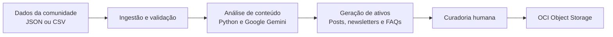

# CommunityLab

Motor inteligente de transformação e distribuição de conteúdo para comunidades digitais.

Projeto desenvolvido para o Hackathon ONE G10, por equipes da Oracle Next Education e Alura.

## Demonstração em vídeo

[](https://youtu.be/cL1PbDTTmdc)

**[Assistir no YouTube](https://youtu.be/cL1PbDTTmdc)**: fluxo completo com Gemini e OCI reais (ingestão, análise com IA, curadoria humana e exportação ao bucket).

## Visão geral

O CommunityLab transforma interações e conquistas de comunidades digitais em conteúdo estratégico para canais como LinkedIn, X (Twitter) e newsletters.

O projeto recebe dados em JSON ou CSV, processa temas e sentimentos, gera ativos de comunicação e apresenta os resultados para curadoria humana antes da aprovação.

### Funcionalidades planejadas

- Leitura e validação de arquivos JSON e CSV.
- Análise de sentimentos e extração de temas.
- Geração de posts, newsletters e FAQs.
- Curadoria, edição e aprovação dos materiais gerados.
- Persistência dos ativos aprovados no OCI Object Storage.
- Execução de testes unitários e de integração.

## Como funciona



O fluxo completo é organizado em três camadas principais:

1. **Apresentação:** interface React (Visão Geral, Ingestão, Curadoria e Exportação), ligada ao backend por uma API FastAPI.
2. **Serviços:** processamento, análise, geração de conteúdo e orquestração.
3. **Persistência:** armazenamento dos ativos aprovados no OCI Object Storage.

Consulte a [documentação de arquitetura](docs/arquitetura.md) para conhecer o fluxo detalhado.

## Stack tecnológica

| Tecnologia | Finalidade |
| --- | --- |
| Python | Linguagem principal do projeto |
| React + Vite | Interface web |
| FastAPI | API entre a interface e o pipeline |
| LangChain | Composição das integrações de IA |
| LangGraph | Orquestração do pipeline |
| Google Gemini | Análise e geração de conteúdo |
| OCI Object Storage | Persistência dos ativos aprovados |
| pandas | Manipulação de dados estruturados |
| Pydantic | Validação dos modelos de dados |
| pytest | Testes automatizados |
| Git e GitHub | Controle de versão e colaboração |
| Trello | Organização das tarefas |

## Estado atual da implementação

| Componente | Estado |
| --- | --- |
| Ingestão e validação de JSON/CSV | Implementada e testada |
| Análise de sentimento e tópicos (Gemini) | Implementada e testada |
| Roteamento RN01/RN02 | Implementado e testado |
| Geração de post LinkedIn, newsletter e FAQ | Implementada e testada |
| Pipeline LangGraph | Implementado e testado |
| OCI Object Storage | Implementado; depende das credenciais no `.env` |
| Curadoria e exportação só de aprovados (RN04) | Implementada e testada |
| Interface React + API FastAPI | Implementada |

Para informações detalhadas, consulte a [documentação técnica e de stack](docs/ARQUITETURA_E_STACK.md).

## Pré-requisitos

- Python 3.10 ou superior.
- Node.js 20 ou superior (interface React).
- Git.
- Chave de API do Google Gemini, quando a integração estiver em uso.
- Credenciais OCI, quando o armazenamento estiver configurado.

## Instalação

### Windows

```powershell
git clone https://github.com/Coutfernandes/MotorInteligente-G10.git
cd MotorInteligente-G10
python -m venv .venv
.venv\Scripts\Activate.ps1
python -m pip install -r backend/requirements.txt
Copy-Item .env.example .env
```

### Linux ou macOS

```bash
git clone https://github.com/Coutfernandes/MotorInteligente-G10.git
cd MotorInteligente-G10
python3 -m venv .venv
source .venv/bin/activate
python -m pip install -r backend/requirements.txt
cp .env.example .env
```

## Configuração

Edite o arquivo `.env` criado a partir de `.env.example`.

```dotenv
GOOGLE_API_KEY=sua_chave_do_gemini
LLM_PROVIDER=gemini
LLM_MODEL=gemini-3.1-flash-lite
```

Para testar a interface sem chave e sem gastar cota, use `LLM_PROVIDER=simulado`: as respostas da IA viram textos fixos marcados com `[Simulado]`.

O `.env` e a chave `oci_api_key.pem` ficam na raiz do projeto. Sem as credenciais da OCI (`OCI_*`), os pacotes ficam salvos só em `data/saida/` e a interface avisa. Para conferir as credenciais: `cd backend` e `python scripts/verificar_oci.py`.

Não versionar credenciais, chaves privadas ou arquivos `.env`.

## Execução

Terminal 1 (API):

```bash
cd backend
uvicorn src.api.main:app --reload
```

Terminal 2 (interface):

```bash
cd frontend
npm install
npm run dev
```

Acesse `http://localhost:5173`.

Para servir tudo por um só endereço, rode `npm run build` dentro de `frontend/` e acesse `http://localhost:8000`.

## Testes

Execute os testes automatizados com:

```bash
cd backend && pytest
cd frontend && npm run lint && npm run build
```

Os testes não gastam cota do Gemini. Para rodar os que chamam a API de verdade: `pytest -m gemini`.

- Roteiro de teste manual das 4 telas: [docs/TESTES_INTERFACE.md](docs/TESTES_INTERFACE.md)
- Requisitos, regras de negócio e onde cada um é testado: [docs/CHECKLIST_FINAL.md](docs/CHECKLIST_FINAL.md)

## Exemplos de demonstração

A pasta `data/exemplos/` tem 3 arquivos prontos para enviar na tela de Ingestão:

| Arquivo | O que demonstra |
| --- | --- |
| `01_relatos_positivos.json` | RN01: relatos positivos com consentimento viram posts de LinkedIn e newsletter |
| `02_duvidas_tecnicas.json` | RN02: dúvidas viram FAQ, e a interface avisa a RN05 (só 1 formato) |
| `03_lote_misto.csv` | Validação (3 registros rejeitados), positivo sem consentimento fora dos posts, negativos e operacionais ignorados |

Detalhes e resultado esperado de cada um: [docs/DEMONSTRACAO.md](docs/DEMONSTRACAO.md).

## Estrutura do projeto

```text
.
├── backend/
│   ├── src/
│   │   ├── api/            # API FastAPI usada pela interface
│   │   ├── ingestao/       # Leitura e validação de JSON/CSV
│   │   ├── ia/             # Tudo que usa inteligência artificial
│   │   │   ├── llm.py          # Cliente do Gemini (e modo simulado)
│   │   │   ├── prompts/        # Prompts em .txt: analise/ e geracao/
│   │   │   ├── analise/        # Sentimento, roteador (RN01/RN02) e agregação
│   │   │   └── geracao/        # Post LinkedIn, newsletter e FAQ (RN06)
│   │   ├── orquestracao/   # Pipeline LangGraph e curadoria (RN04)
│   │   ├── armazenamento/  # OCI Object Storage + cópia local (RN03)
│   │   └── caminhos.py     # Pastas do projeto
│   ├── tests/              # Testes automatizados (pytest)
│   ├── scripts/            # verificar_oci.py
│   └── requirements.txt
├── frontend/               # Interface React (Vite + TypeScript)
│   └── src/visoes/         # Visão Geral, Ingestão, Curadoria, Exportação
├── data/                   # Dataset, amostra, exemplos/ (F14) e pacotes gerados (saida/)
├── docs/                   # Documentação técnica
├── .env.example
└── README.md
```

## Fluxo de contribuição

O projeto utiliza Gitflow.

- `main`: versão estável.
- `develop`: integração das funcionalidades.
- `feature/nome-da-tarefa`: desenvolvimento de uma tarefa específica.

### Iniciar uma tarefa

```bash
git checkout develop
git pull origin develop
git checkout -b feature/nome-da-tarefa
```

### Enviar alterações

```bash
git add .
git commit -m "feat: descreve a alteração"
git push -u origin feature/nome-da-tarefa
```

Abra um Pull Request para a branch `develop`, descreva o que foi alterado e informe os testes executados.

Não faça commits diretamente em `main` ou `develop`.

## Equipe — Grupo 10

| Integrante | Responsabilidade | Atuação |
| --- | --- | --- |
| Matheus Coutinho | Tech Lead / Arquitetura | Gitflow, OCI Object Storage, arquitetura e revisão de PRs |
| Matheus Antero | Backend — IA e prompts | Análise de sentimentos, prompts e geração de conteúdo |
| Nathalia Marques | Backend — Dados e pipeline | Ingestão, validação, tratamento de erros e datasets |
| Nicolas Firmino | Frontend | Interface, visualização, curadoria e aprovação |
| Rafael Victor | Produto, documentação e demonstração | Organização, documentação, testes e apresentação |

## Documentação relacionada

- [Arquitetura do sistema](docs/arquitetura.md)
- [Stack técnica e estado da implementação](docs/ARQUITETURA_E_STACK.md)
- [Demonstração: vídeo e 3 exemplos](docs/DEMONSTRACAO.md)
- [Testes de interface](docs/TESTES_INTERFACE.md)
- [Checklist final](docs/CHECKLIST_FINAL.md)
