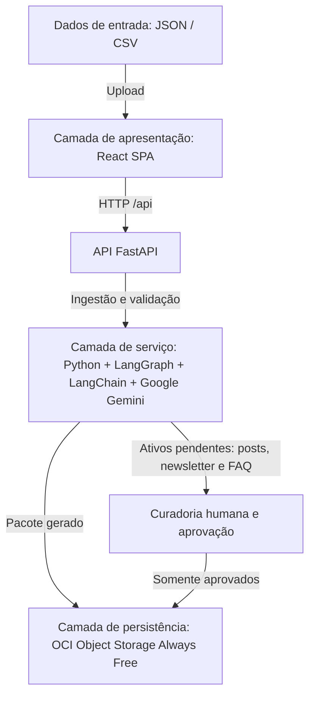

# Arquitetura do Sistema — CommunityLab

Este documento descreve a organização técnica e o fluxo de dados planejado para o CommunityLab. A arquitetura utiliza três camadas principais para separar a interface, o processamento com inteligência artificial e a persistência dos dados aprovados.

## Visão geral

O CommunityLab recebe informações da comunidade em arquivos JSON ou CSV, processa os dados por meio de serviços de IA e apresenta os conteúdos gerados para revisão humana. Somente os ativos aprovados são enviados à camada de persistência.

Essa separação permite que a equipe desenvolva, teste e mantenha as interfaces, os componentes de IA e o armazenamento de forma independente.

## Diagrama de arquitetura

## Camadas da aplicação

### Camada de apresentação

Responsável pela interação com os usuários. A aplicação web em React (pasta `frontend/`) tem quatro visões: Visão Geral, Ingestão, Curadoria e Exportação. Ela conversa com o backend apenas pela API FastAPI (`backend/src/api`), sem regra de negócio própria.

Tecnologias principais:

- React + TypeScript + Vite
- FastAPI (ponte HTTP com a camada de serviço)

### Camada de serviço

Contém as regras de negócio e o processamento do conteúdo. Nesta camada, os dados são preparados para os prompts, enviados ao modelo de linguagem e transformados em posts e FAQs.

Tecnologias principais:

- Python
- LangChain
- Google Gemini

### Camada de persistência

Armazena o pacote gerado pelo pipeline (`pacotes/<id>.json`, RN03) e, após a curadoria, o pacote somente com os ativos aprovados (`aprovados/<id>.json`, RN04). O armazenamento utiliza OCI Object Storage, no plano Always Free, com uma cópia local em `data/saida/` usada pela curadoria.

## Fluxo de dados

1. O usuário fornece dados da comunidade no formato JSON ou CSV.
2. A camada de apresentação envia os arquivos para a camada de serviço.
3. Os dados passam pela ingestão e validação.
4. Os prompts são preparados e enviados ao Google Gemini por meio do LangChain.
5. O modelo gera posts e FAQs.
6. Os ativos gerados são apresentados para curadoria humana.
7. Após a aprovação, os conteúdos são armazenados no OCI Object Storage.

## Responsabilidades por etapa

| Etapa | Responsabilidade | Resultado esperado |
| --- | --- | --- |
| Entrada de dados | Receber arquivos JSON ou CSV | Dados disponíveis para processamento |
| Ingestão | Validar estrutura, conteúdo e formato dos dados | Dados validados |
| Orquestração | Coordenar prompts e chamadas aos serviços de IA | Solicitações de IA padronizadas |
| Geração | Criar posts e FAQs a partir dos dados processados | Ativos de conteúdo gerados |
| Curadoria | Permitir análise, edição e aprovação humana | Conteúdos validados pela equipe |
| Persistência | Armazenar os ativos aprovados | Conteúdo disponível no OCI Object Storage |

## Considerações técnicas

- Os dados de entrada devem passar por validação antes do processamento.
- As integrações com serviços externos devem manter suas credenciais fora do controle de versão.
- O modelo de IA atua como componente gerador, enquanto a curadoria humana é responsável pela validação final.
- A camada de apresentação não deve implementar diretamente as regras de integração com o modelo ou com o armazenamento.
- Os componentes devem ser desacoplados para facilitar testes, substituições e evolução da arquitetura.

## Estado da implementação

Todas as camadas descritas aqui estão implementadas. Para o estado detalhado da implementação e da infraestrutura, consulte a [Documentação técnica — CommunityLab](ARQUITETURA_E_STACK.md).
